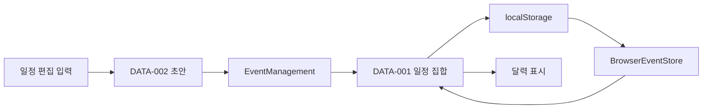

# CalendarApp Web 데이터 요구사항

## 1. 데이터 목록

| Data ID | 이름 | 설명 | 생산 Module | 소비 Module | UI 사용 위치 | 관련 API | 상태 |
| --- | --- | --- | --- | --- | --- | --- | --- |
| DATA-001 | 일정 집합 | 현재 관리하는 일정들 | EventManagement / BrowserEventStore | App UI, Calendar | SCR-001~003.json#calendar, SCR-004·005 트리 | API-001, API-003 | Review |
| DATA-002 | 일정 초안 | 제목·시작·종료·색상 입력 | App UI | EventManagement | MOD-001.json#editor-form | API-003 | Review |
| DATA-003 | UI 편집·오류 상태 | editingId, editorOpen, formError, storageError | App UI / BrowserEventStore | App UI | MOD-001.json#editor, COMMON-003.json#storage-error | API-001 | Review |

상세 일정 형식은 [DATA-001](11_data_spec/DATA-001_Events.md)에 정의한다. DATA-002는 title/start/end/color의 문자열 초안이며 DATA-001의 저장 형식과 같은 정본으로 취급하지 않는다. DATA-003의 편집 초안은 메모리 상태이다. 접힘 id 집합은 별도 키 workplan-calendar-collapsed-v1로 저장하며 선택·보기·기준 날짜는 메모리 상태이다.

## 2. 데이터 흐름

## 3. 보존 및 품질 규칙

| Data ID | 보존 범위 | 정합성·검증 | 민감도 | 확인 필요 사항 |
| --- | --- | --- | --- | --- |
| DATA-001 | 동일 origin·프로필의 localStorage | 필수 문자열·날짜·중복 id·부모 정합성 검사; 저장 시 제목 trim·기간 비교 | 제목에 개인 정보가 들어갈 수 있음; 공식 등급 미정 | quota·데이터 삭제·손상 입력·다중 탭 경합 |
| DATA-002 | 편집 중 React 메모리 | 폼 required와 저장 단계 검사 | 일정 내용과 동일 | 비정상 날짜·시간대 변경 |
| DATA-003 | React 메모리 | 오류 문자열과 모달 표시 상태 | 일반 UI 상태 | 새로고침 뒤 초안 복원 없음 |

[모듈 책임](10_ModuleMapping.md)과 [인터페이스](12_APISpecification.md)를 직접 참조한다. 서버 정본 데이터와 브라우저 캐시 구분에서 일정은 브라우저 자체 정본이며 서버 복제본은 없다.
