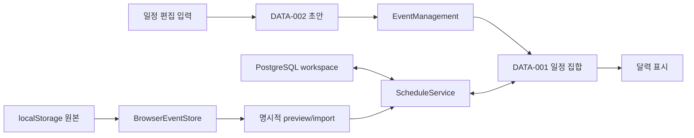

# CalendarApp Web 데이터 요구사항

## 1. 데이터 목록

| Data ID | 이름 | 설명 | 생산 Module | 소비 Module | UI 사용 위치 | 관련 API | 상태 |
| --- | --- | --- | --- | --- | --- | --- | --- |
| DATA-001 | 일정 집합 | 현재 관리하는 일정들 | ScheduleService / ScheduleRepository | WorkspaceClient, App UI, Calendar | SCR-001~003.json#calendar, SCR-004·005 트리 | API-004, API-003 | Review |
| DATA-002 | 일정 초안 | 제목·시작·종료·색상 입력 | App UI | EventManagement | MOD-001.json#editor-form | API-003 | Review |
| DATA-003 | UI 편집·오류 상태 | editingId, editorOpen, formError, storageError | App UI / BrowserEventStore | App UI | MOD-001.json#editor, COMMON-003.json#storage-error | API-004 | Review |
| DATA-005 | 일정 체크리스트 | 항목 id·text·done 목록 | EventManagement / BrowserEventStore | 편집 UI | MOD-001#checklist | API-004 | Review |

상세 일정 형식은 [DATA-001](11_data_spec/DATA-001_Events.md)에 정의한다. DATA-002는 title/start/end/color의 문자열 초안이며 DATA-001의 저장 형식과 같은 정본으로 취급하지 않는다. DATA-003의 편집 초안은 메모리 상태이다. 접힘 id 집합은 별도 키 workplan-calendar-collapsed-v1로 저장하며 선택·보기·기준 날짜는 메모리 상태이다.

## 2. 데이터 흐름

## 3. 보존 및 품질 규칙

| Data ID | 보존 범위 | 정합성·검증 | 민감도 | 확인 필요 사항 |
| --- | --- | --- | --- | --- |
| DATA-001 | PostgreSQL workplanner.workspace | 필수 문자열·날짜·중복 id·부모 정합성 검사; 저장 시 제목 trim·기간 비교 | 제목에 개인 정보가 들어갈 수 있음; 공식 등급 미정 | DB 연결·손상 입력·revision 충돌 |
| DATA-002 | 편집 중 React 메모리 | 폼 required와 저장 단계 검사 | 일정 내용과 동일 | 비정상 날짜·시간대 변경 |
| DATA-003 | React 메모리 | 오류 문자열과 모달 표시 상태 | 일반 UI 상태 | 새로고침 뒤 초안 복원 없음 |

[모듈 책임](10_ModuleMapping.md)과 [인터페이스](12_APISpecification.md)를 직접 참조한다. 일정·설정의 정본은 서버이며 브라우저 snapshot은 표시용 복제본이다.

## DATA-004 색상 프리셋 설정

| Data ID | 이름 | 생산·소비 | UI 위치 | 관련 API | 상태 |
| --- | --- | --- | --- | --- | --- |
| DATA-004 | 프리셋 목록과 활성 프리셋 | ScheduleService / WorkspaceClient / 설정 UI | COMMON-001#color-settings, MOD-002 | API-004 | Review |

설정은 version=1, activePresetId와 presets[{id,name,colors}]를 가진다. 프리셋 id는 비어 있지 않고 고유하며 이름은 trim 후 비어 있지 않아야 한다. colors는 #RRGGBB 배열이며 서로 다른 색이 최소 2개여야 한다. 활성 id는 목록에 있어야 한다. 단계 초과는 순환하고 자동색이 부모의 실제 표시색과 같으면 다음 다른 후보를 사용한다. 설정 초안은 팝업 메모리에만 존재한다. 저장 성공 후에만 활성 설정을 바꾼다. 손상·쓰기 실패는 설정 원본을 보존하고 오류를 표시한다.

상세 형식·기본값·보존·오류 경계는 [DATA-004](11_data_spec/DATA-004_ColorSettings.md)를 참조한다.

## DATA-005 일정 체크리스트

FR-015의 checklist는 DATA-001 일정 및 DATA-002 초안의 선택적 배열이며 부재는 빈 목록이다. 항목은 고유 id·text·done을 가지며 배열 순서를 유지한다. UI는 편집용 깊은 복사만 변경하고 저장할 때 정규화·검증한다. API-004로 일정과 함께 저장하며 별도 체크리스트 저장 키를 추가하지 않는다. 상세: [DATA-005](11_data_spec/DATA-005_Checklist.md).

계획·작업: DATA-001·DATA-002에 구분을 전달한다. [일정 집합 상세](11_data_spec/DATA-001_Events.md)의 호환·검증 계약을 따르며 MOD-001 kind-field에서 입력한다.

## 공통 일정·MCP 현재 계약

FR-017~019 / DATA-001~007 / API-004·005. 서버의 단일 개인 일정 workspace가 정본이다. revision은 전체 일정·설정의 정수 수정 버전이다. 모든 변경은 expectedRevision과 requestId를 요구하며 PostgreSQL 트랜잭션 안에서 잠금·검증·저장을 수행한다. 같은 requestId·같은 본문은 이전 응답을 반환하고 다른 본문은 거부한다. 과거 버전 변경은 409 충돌이다. 브라우저는 5초 재조회와 포커스 복귀 재조회를 하되 편집 초안은 보존하며 편집을 열 때의 버전으로 저장한다.

신규 기본값 plan/auto, 기존 kind 부재 task·colorMode 부재 manual이다. 현지 날짜는 유효한 초 단위 datetime, offset 입력은 workspace 시간대로 정규화한다. 부모 기간·단계 색상은 전체 계층에서 계산 후 작업 표시 투영을 한다. 부모 날짜 이동은 거부하고 계층 이동은 순환을 거부한다. 삭제 시 자식을 한 단계 승격한다. 체크리스트는 검증 후 trim한다.

브라우저 v1/v2 일정·프리셋은 읽기 전용 이전 원본이다. import preview는 ID 충돌과 잘못된 계층·날짜를 차단한다. 기존 동일 ID 내용이 같은 경우만 건너뛰며 다른 내용은 거부한다. 색상 설정 교체는 미리보기에서 별도 선택한다. 적용은 원자적이며 실패 시 서버 집합과 브라우저 원본 모두 불변이다. 접힘·선택 상태는 로컬에 남긴다. 서버 연결 실패 시 로컬 저장으로 우회하지 않는다.

DATA-006은 공통 workspace snapshot(revision/items/settings/timeZone), DATA-007은 브라우저 가져오기 미리보기다. 일정·설정 원본과 UI 초안/표시 결과를 구분한다.

## DATA-008 AI 등록 초안

[API-006](12_api_spec/API-006_ScheduleProposals.md). id/version/status, 불변 original, 편집 draft(nodes/selectedRefs), preview(baseRevision/additions/rows/created), result를 PostgreSQL proposals에 보존한다. 초안 버전과 일정 revision은 별개다. 대기 목록은 id/version/status/title/count/createdAt만 제공한다. 실제 일정에 포함되지 않아 달력에 미리 표시되지 않는다. 웹 편집 중 미저장 입력은 React 상태이며 폴링이 이를 덮어쓰지 않는다. 확정 일정의 ID는 서버 검증 미리보기에서 고정된다.
