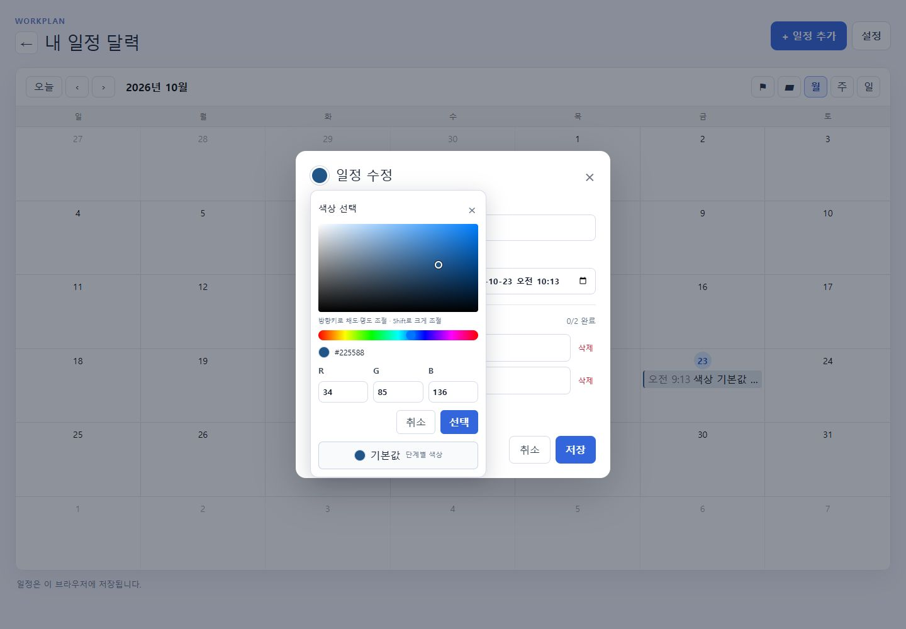
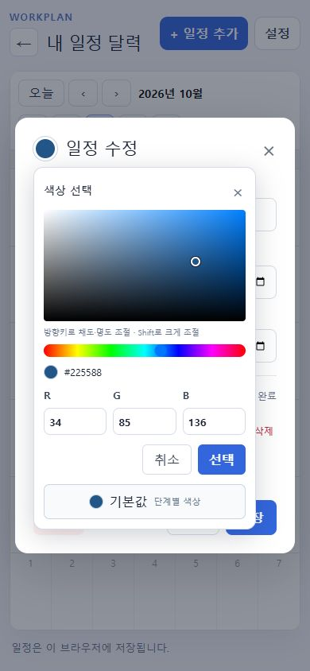

# 색상 선택창 기본값 검증

- 요청: 색상 선택창 맨 아래의 기본값 버튼으로 설정의 단계별 자동 색상을 따른다.
- 책임: colorValues는 순수 RGB/HSV 변환, ScheduleColorPicker는 선택창 내부 초안과 입력, ScheduleColorControl은 열기·선택·복원 연결, ScheduleEditor는 일정 초안과 저장·취소를 담당한다.
- 변경: 브라우저 기본 색상창을 앱 dialog로 교체하고 기존 헤더 복원 링크를 하단 기본값으로 옮겼다. 채도·명도 면, 색상 각도, RGB 입력을 지원한다. 선택은 실제 색상이 달라질 때 개별 지정하며 기본값은 auto 모드로 복원한다.

## 검증 결과

- npm run build: TypeScript/Vite 통과, 66 modules.
- 순수 변환 16개 검사 통과. 그중 RGB 4096개 조합 왕복 검증 포함. [결과](color-values.json).
- RGB 22/132/91 선택 결과 #16845b와 개별 지정 모드를 확인했다.
- 기본값 후 편집 취소: 저장된 개별 색상 유지. 기본값 후 저장·새로고침: 자동 모드 유지.
- 1단계 설정을 #3366dd에서 #225588로 변경·일괄 적용한 뒤 복원된 일정도 #225588을 따랐다. 고정 색상 복사가 아닌 자동 모드 연결을 확인했다.
- 색상창 Escape·취소·닫기·바깥 클릭은 해당 색상창만 닫으며 제목·체크리스트 초안을 보존했다. 바깥 클릭 후 재개방 확인.
- 채도·명도 포인터 선택, 방향키 조절 및 색상 각도 Home 키 조절을 확인했다.
- 모바일 390×844: 팝업 280×456.5, x42/y209.75, 기본값 버튼 y609.25/h44. 문서 가로폭390으로 가로 넘침 없음. [측정](mobile.json).
- 데스크톱 1440×1000 실제 DOM 좌표로 MOD-001을 동기화했다. [측정](geometry.json).
- MOD-001 스키마·소스 연결·렌더 계약 Valid, 오류0·경고0. 공용 와이어프레임 뷰어 시각 일치 검증은 Unverified로 유지한다.

## 리스크와 확인 범위

- 설정 저장·일정 저장소 스키마와 체크리스트 정규화는 변경하지 않았다. 기본값은 기존 자동색상 복원 콜백을 사용한다.
- 선택창은 중첩 dialog이며 이벤트 전파를 차단해 상위 편집창 닫힘을 방지한다.
- 확인 환경: 로컬 격리 Vite 5178, IAB Chromium, 데스크톱 및 모바일 뷰포트. 다른 브라우저·실제 터치 단말은 미검증.
- 기존 dist/index.html 및 postgresql/supervisor.log 변경은 작업 커밋에서 제외한다. 원격 푸시는 요청되지 않아 수행하지 않는다.

