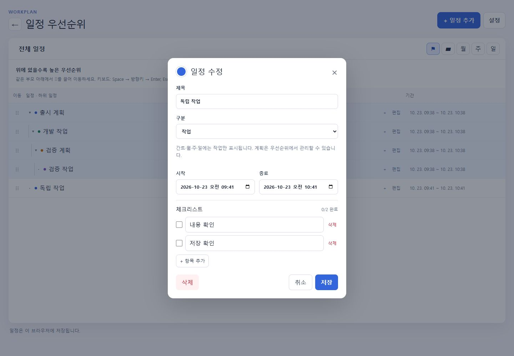
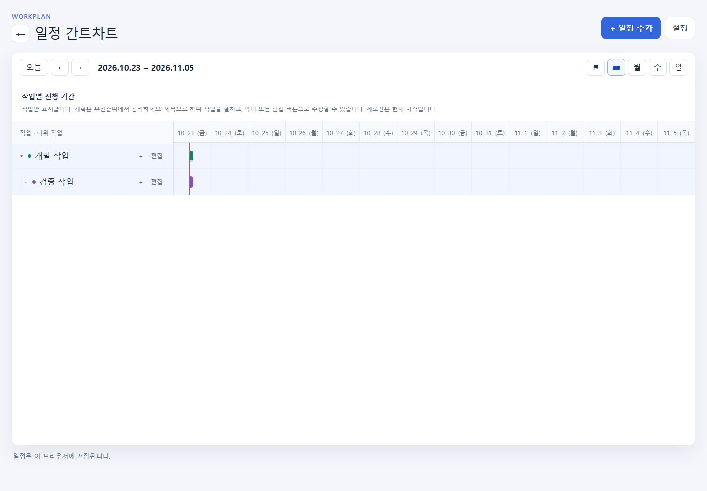
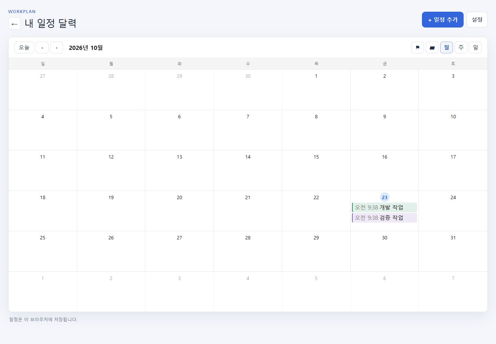
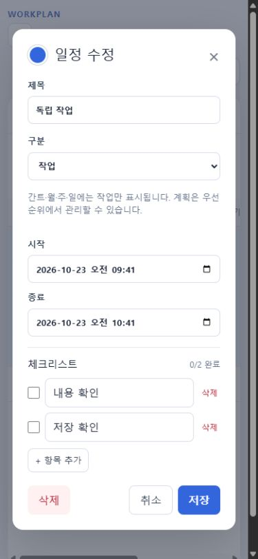

# 계획·작업 구분 검증

사용자 승인 범위: 일정 편집의 계획/작업 콤보박스와 간트·월·주·일 작업만 표시. 우선순위는 전체를 관리한다.

## 구현 책임과 계약

- EventManagement TASK-001: types.ts, scheduleKinds.ts, useSchedules.ts, ScheduleEditor.tsx, MOD-001의 kind-field/입력/안내. 순수 구분 검증·표시 투영과 초안·저장 검증을 분리한다.
- BrowserEventStore TASK-001: scheduleStorage.ts에서 구분 부재를 task로 복원하고 잘못된 명시값은 읽기 오류로 거부한다. v1 원본과 v2 키를 유지한다.
- SCR-001 TASK-001: App 조립과 GanttView 안내를 소유한다. 전체 계층의 기간·색상을 먼저 계산한 뒤 작업만 전달한다. 계획의 접힘은 무시하고 작업의 접힘은 공유한다.
- SCR-002/003 TASK-001: 해당 JSON 의미·상태의 동기화만 소유한다. 공유 코드 소유를 복제하지 않는다.
- 입력 역할: MOD-001·관련 SCR JSON/현재 웹 앱 source·요구사항/계약/Task는 수정 대상, 기존 Evidence/외부 SDK·DB·서버·운영 origin은 읽기 전용/변경 금지, 이 폴더는 검증 근거 생성 대상이다. 현재 package.json의 단일 앱 경계 안에서 구현했다.
- 최상위 14_ExecutionPlan은 확인만(진입점·마일스톤 불변). 2단계 SCR-001은 기존 간트 접힘 설명을 현재 기준으로 수정했고 다른 2단계는 Task 순서·의존성·소유권 불변으로 확인만이다. 관련 Markdown 메타데이터는 같은 작업에서 갱신한다.

## 실제 검증

- npm run build: TypeScript/Vite 통과, 67 modules.
- [정책·저장 경계 12건](policy-storage.json): 구분 누락·허용/손상 값, 계획 제외/작업 보존, 접힌 계획 아래 작업, 작업 아래 중간 계획·손자, 표시 깊이, 원본 불변, v1 원본 보존, v2 왕복, 손상 원본 보존, 전체 깊이 색상/기간, 계획 삭제 후 자식 보존. 신규 테스트 파일 없이 현재 모듈을 직접 실행했다.
- 격리 origin 127.0.0.1:5179, IAB Chromium에서 계획→작업→계획→작업 계층을 UI로 만들었다.
- [실제 UI 결과](ui.json): 월·주·일 작업2/계획0, 최상위 계획 접힘에도 간트 작업2, 작업 접힘 후 작업1.
- 새 일정 기본값 작업, 구분 변경 취소 후 작업 유지, 작업→계획 저장 후 새로고침·편집에서 계획 복원을 확인했다. 계획 아래 편집에서 상위 계획 이름을 확인했다.
- 모바일에서 계획으로 저장한 독립 일정은 월 보기에서 숨겨지고 다른 작업은 유지됐다.
- [편집창 실측](editor-geometry.json): 1440×1000. [모바일 실측](mobile.json): 390×844, 선택란과 저장 버튼이 보이며 가로 넘침 없음.
- [전체 와이어프레임 검증](wireframe-validation.json): 10개 JSON, 오류0·경고0. MOD-001 좌표는 실제 편집창 측정으로 갱신하고 화면별 표시 의도와 FR-016 연결을 대조했다. 기존 SCR-004/005의 전체 시각 재설계는 하지 않았다.

## 문서 대조와 한계

FR-016 → SRS Web 책임 → MOD-001 kind-field 및 SCR-001~005 → EventManagement/BrowserEventStore/화면 조립 → DATA-001/002와 API-001 보존 계약을 대조했다. 기존 NFR-001/002를 적용한다. 상위 계약과 코드의 필수 차이는 없다. 문서 위치/소유 ID 변경은 없고 신규 FR-016과 구분 UI binding은 정적 검증했다. 공용 뷰어에서 참조 문서를 실제 열어 확인하는 경로와 전체 시각 reconciliation은 미검증이다.

운영 origin/DB/서버/SDK 원본은 변경하지 않았다. 실제 터치 단말, 다중 탭 동시 편집, quota 오류 UI 전체 경로, 전체 접근성 감사는 미검증이다. 전용 Web 구현 템플릿을 새로 만들지 않고 기존 React/TypeScript 구조와 순수 정책 패턴을 확장했다. 프로젝트 전용 변경이므로 별도 재사용 템플릿 후보는 만들지 않는다.

Git 기준 HEAD a86a7a0; 기존 dist/index.html·postgresql/supervisor.log dirty는 선별 커밋에서 제외한다. 이전 local-only 완료 이후 master_not_pushed는 원격 미요청 상태이며 필수 master 반영 누락/충돌은 없었다. 이번에도 로컬 master만 반영하고 원격 push는 수행하지 않는다.

